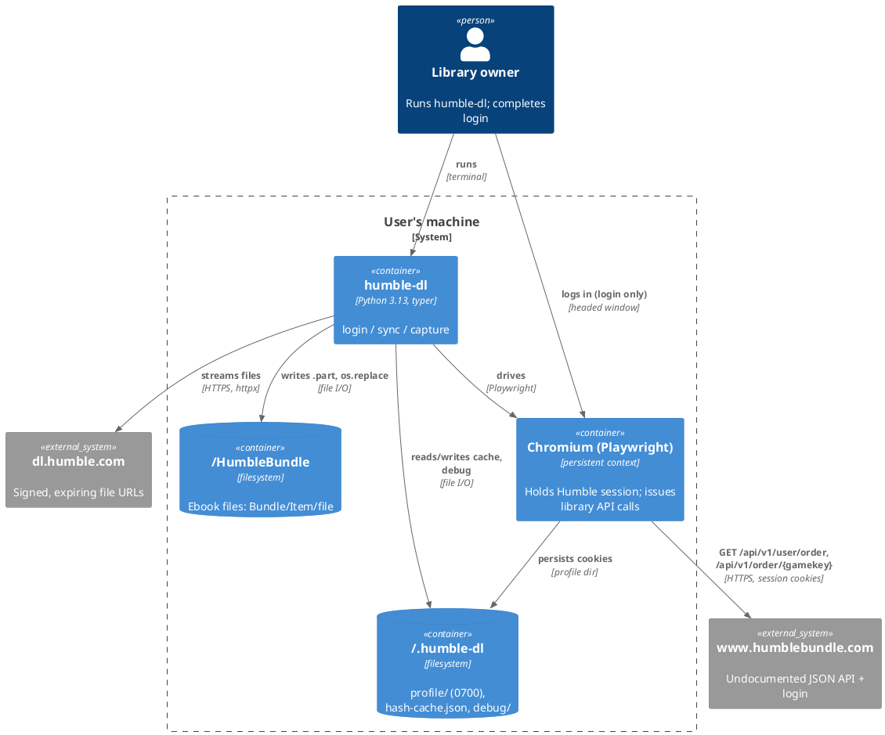

# System architecture (proposed)

Single-process CLI on the user's Mac. Two external HTTP dependencies; all
state is local files.

## Communication

| From → To | Protocol | Sync/async | Failure handling |
|-----------|----------|------------|------------------|
| browser → humblebundle.com | HTTPS JSON | sync, ≤2 req/s | 401 → exit 2; 429/5xx backoff ×5; bad JSON → debug dump, exit 3 |
| cli → dl.humble.com | HTTPS stream | async, concurrency 4 | 403 → refresh order once; 5xx/network ×3; md5 mismatch → discard `.part` |
