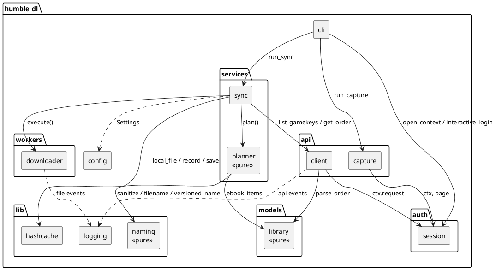

# Components (proposed)

## Responsibilities

| Module | Kind | Responsibility |
|--------|------|----------------|
| `cli` | shell | typer commands; maps exceptions → exit codes |
| `config` | pure loader | `Settings` from injected env + home |
| `auth/session` | shell | persistent Chromium context, session probe, interactive login |
| `api/client` | shell | rate-limited in-browser API calls; drift dumps to debug dir |
| `api/capture` | shell + pure `sanitize` | record traffic → sanitized fixtures |
| `models/library` | pure | pydantic models; `ebook_items` projection |
| `lib/naming` | pure | filesystem-safe names; collision + version naming |
| `lib/hashcache` | shell | `(path,size,mtime_ns) → md5` cache |
| `lib/logging` | infra | JSON logs; URL/gamekey redaction |
| `services/planner` | pure | library + disk view → `Skip` / `Fetch` / `ArchiveThenFetch` |
| `services/sync` | shell | sequences fetch → plan → space check → execute → summary |
| `workers/downloader` | shell | stream `.part`, verify, atomic place, refresh on 403 |
